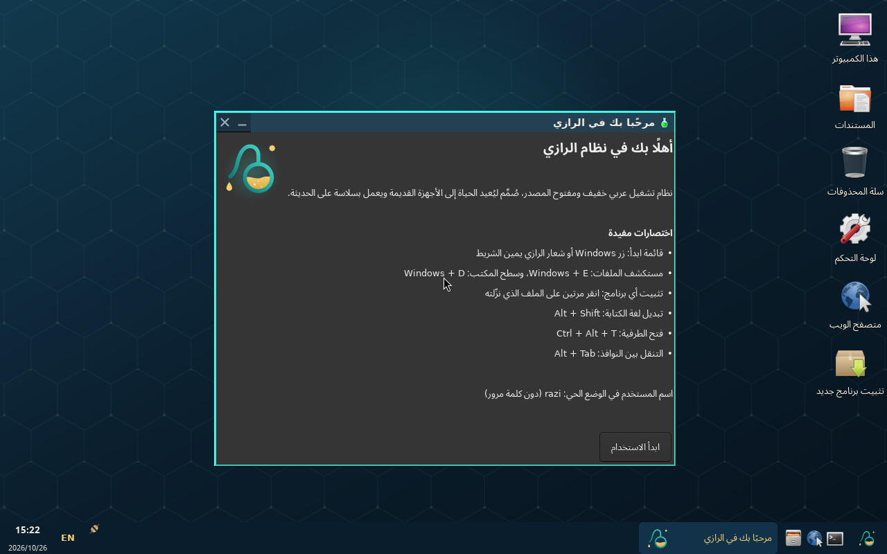
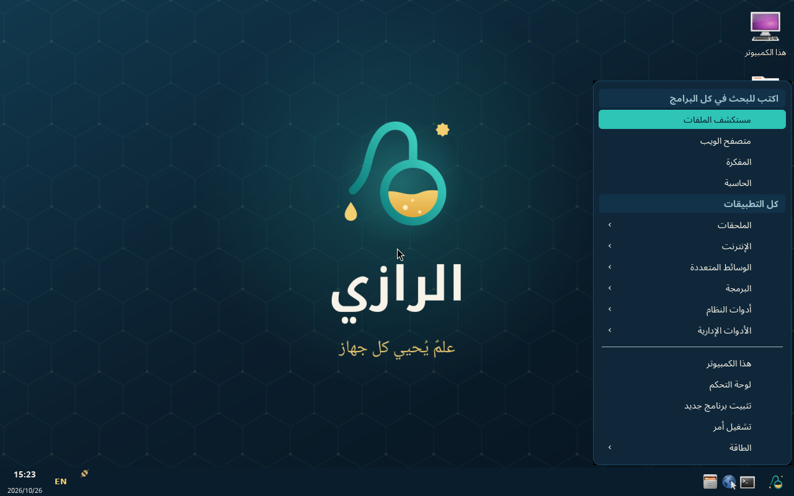
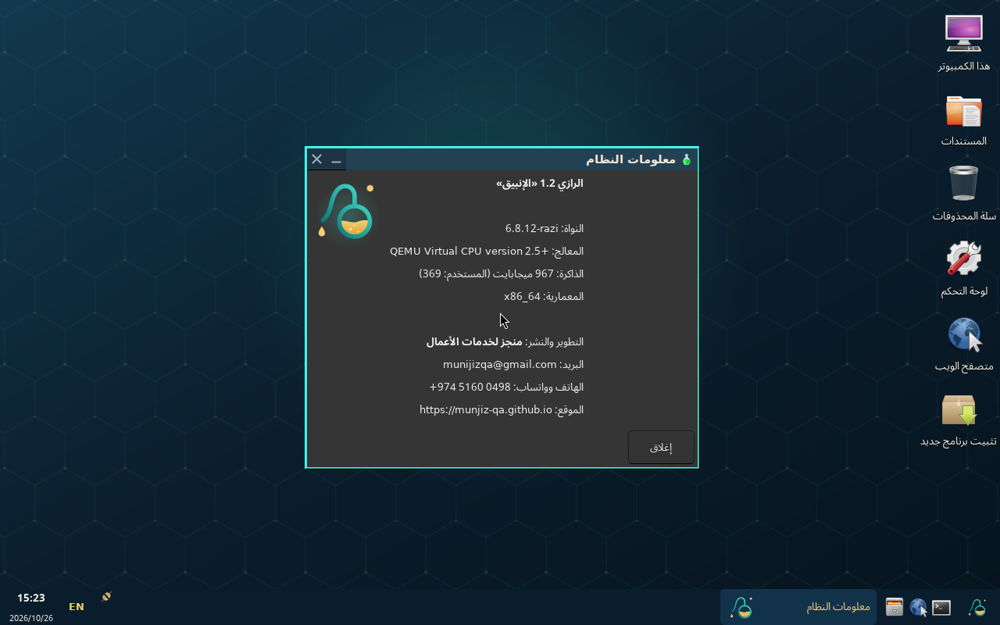
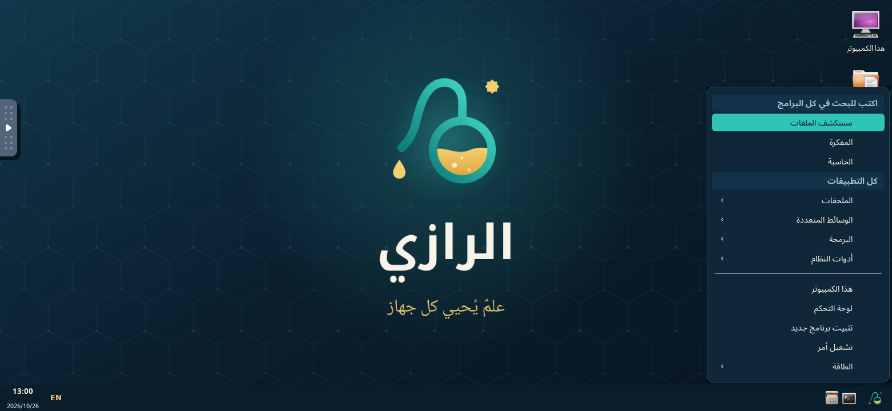

<div align="center">


# الرازي · Razi OS

**نظام تشغيل عربي خفيف ومفتوح المصدر، للأجهزة القديمة والحديثة**

> علمٌ يُحيي كل جهاز

الإصدار **1.2 «الإنبيق»** · تطوير ونشر **[منجز لخدمات الأعمال](https://munjiz-qa.github.io/)**

</div>

---

## لماذا «الرازي»؟

يحمل النظام اسم العالم أبي بكر الرازي، الطبيب والكيميائي الذي قدّم التجربة على التقليد. ومن هذه الروح جاء النظام: تجربة عربية كاملة من أول شاشة، تعيد الحياة إلى الأجهزة القديمة وتعمل بسرعة على الحديثة.

الشعار دورق تقطير (الإنبيق) ترسم رقبته حرف الراء، وتسقط منه قطرة المعرفة، وتعلوه نجمة ثمانية رمزًا لإشراقة العقل. ألوانه الفيروزي والذهبي على أزرق الليل.

## الإصدارات

| الإصدار | الملف | الجهاز |
|---|---|---|
| **الرازي الكامل** | `razi-1.2-full-amd64.iso` | أجهزة الكمبيوتر 64 بت: مكتب وإنترنت ووسائط وبرامج ويندوز، مع مثبّت على القرص |
| **الرازي الخفيف** | `razi-1.2-lite-amd64.iso` | الأجهزة القديمة والضعيفة، من 512 ميجابايت ذاكرة |
| **الرازي للهاتف** | `razi-android.sh` و `razi-1.2-phone-arm64.tar.xz` | هواتف أندرويد عبر تطبيق Termux، دون مسح أندرويد ودون root |
| **الرازي لـ Raspberry Pi** | `razi-1.2-raspberrypi-arm64.img.xz` | Raspberry Pi 3 و4 و400 و5 |

نسخ التثبيت تُطلب من منجز عبر واتساب [+974 5160 0498](https://wa.me/97451600498) مع بصمات SHA-256، والتجربة في المتصفح على **[munjiz-qa.github.io/razi](https://munjiz-qa.github.io/razi/)**.

## المزايا

| المجال | التفاصيل |
|---|---|
| العربية أولًا | الواجهة والقوائم والرسائل بالعربية، واتجاه من اليمين إلى اليسار، وخطوط Noto العربية وأميري، والتبديل إلى الإنجليزية بـ Alt + Shift |
| واجهة مألوفة | شريط مهام، وقائمة ابدأ بالبحث، وأيقونات سطح المكتب، ولوحة تحكم بـ17 قسمًا، واختصارات زر Windows |
| خفة الوزن | نحو 300 ميجابايت ذاكرة بسطح المكتب كاملًا، مع ذاكرة مضغوطة zram وحماية من التجمد earlyoom |
| نواة الرازي | لينكس ‎6.8.12-razi مجمّعة باسم الرازي وشعار إقلاعه، مع نواة موقّعة احتياطية للإقلاع الآمن |
| الإقلاع | BIOS و UEFI و Secure Boot، وخيار «رسوميات آمنة» للأجهزة القديمة |
| تثبيت أي برنامج | النقر المزدوج على ‎.deb أو Flatpak أو AppImage أو ‎.exe و‎.msi (برامج ويندوز في الإصدار الكامل) |
| العتاد | مشغلات Intel و AMD و NVIDIA، وبطاقات Wi-Fi الشائعة، والطابعات والماسحات والبلوتوث |

## التشغيل السريع

**من ذاكرة USB:** اكتب ملف ISO على الذاكرة ببرنامج Rufus أو balenaEtcher أو Ventoy، ثم أعد تشغيل الجهاز واختر الإقلاع من USB. يبدأ النظام بالعربية مباشرة، ومن سطح المكتب اختر «تثبيت الرازي» للتثبيت على القرص.

**على جهاز وهمي:**
```bash
qemu-system-x86_64 -m 2048 -cdrom razi-1.2-full-amd64.iso -boot d -vga std
```

**على الهاتف:** ثبّت Termux من F-Droid، ونزّل `razi-android.sh` إلى مجلد التنزيلات، ثم:
```bash
termux-setup-storage && bash /sdcard/Download/razi-android.sh
razi        # يفتح سطح المكتب في متصفح الهاتف
```

**على Raspberry Pi:** اكتب `razi-1.2-raspberrypi-arm64.img.xz` على بطاقة الذاكرة ببرنامج Raspberry Pi Imager، ثم شغّل الجهاز.

## بيانات الدخول

| الإصدار | المستخدم | كلمة المرور |
|---|---|---|
| الوضع الحي (USB) | `razi` | بلا كلمة مرور، والدخول تلقائي |
| بعد التثبيت على القرص | يختاره المستخدم أثناء التثبيت | يختارها المستخدم |
| Raspberry Pi | `razi` | `razi` (غيّرها بالأمر `passwd`) |

## البناء من المصدر

يتطلب Ubuntu 24.04، وصلاحيات المدير، واتصالًا بالإنترنت.

```bash
sudo ./kernel/build-kernel.sh            # نواة الرازي (نحو ساعة على 4 أنوية)
cd pc
sudo ./build.sh deps
sudo EDITION=lite ./build.sh             # out/razi-1.2-lite-amd64.iso
sudo EDITION=full ./build.sh             # out/razi-1.2-full-amd64.iso
cd ../arm
sudo ./build-arm.sh all                  # الهاتف و Raspberry Pi
```

## هيكل المستودع

```
pc/            بناء نسخة الكمبيوتر: build.sh والسكربتات وطبقات الهوية والمثبّت
arm/           بناء نسخة الهاتف و Raspberry Pi
kernel/        إعدادات نواة الرازي وشعار إقلاعها وسكربت بنائها
branding/      الشعار والخلفية بصيغة SVG و PNG
web/           النسخة التجريبية التي تعمل في المتصفح
docs/          صور الشاشة
```

كل ما تراه في الواجهة ملفات نصية معلّقة بالعربية: قائمة ابدأ في `pc/overlay/usr/share/razi/start/menu.all.csv`، ولوحة التحكم في `pc/overlay/usr/share/razi/control-panel/`، وشريط المهام في `pc/overlay/etc/xdg/tint2/razi.tint2rc`.

## صور من النظام

<p align="center">




</p>

## التواصل والدعم

**منجز لخدمات الأعمال**، المطوّر والناشر:

| | |
|---|---|
| البريد | [munijizqa@gmail.com](mailto:munijizqa@gmail.com) |
| الهاتف وواتساب | [+974 5160 0498](https://wa.me/97451600498) |
| الموقع | [munjiz-qa.github.io](https://munjiz-qa.github.io/) |

## الترخيص

سكربتات البناء والهوية والأدوات منشورة بترخيص [GPL-3.0](LICENSE). الحزم المضمّنة في الصور (لينكس وأوبونتو وغيرهما) تبقى بتراخيصها الأصلية، ومصادرها متاحة من مستودعات أوبونتو.
